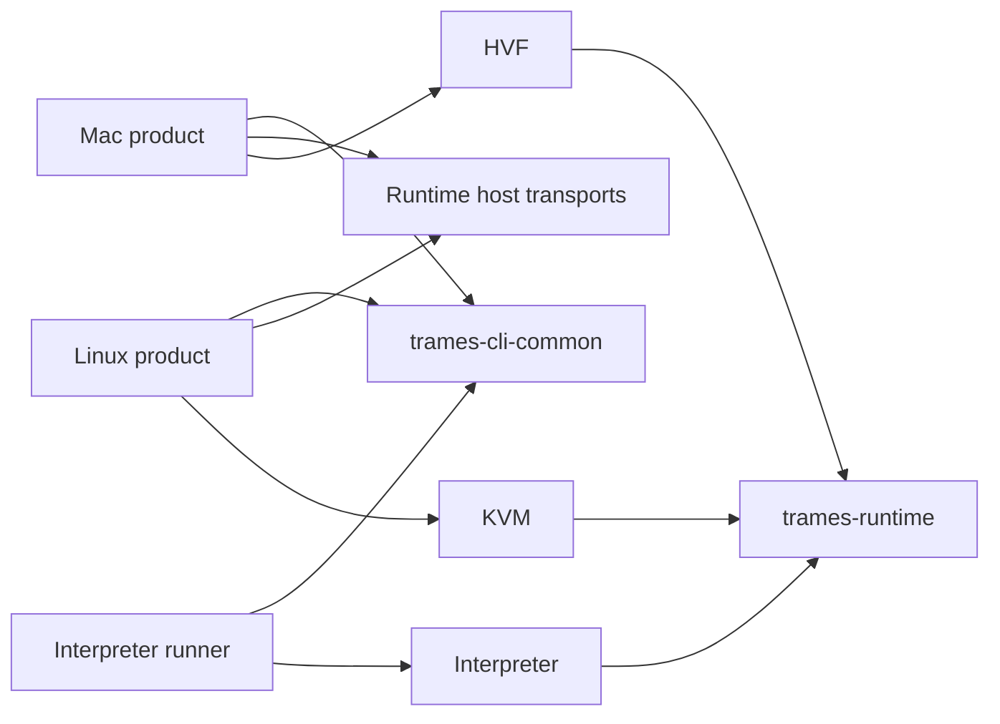

# Shared host CLI

The independent [trames-cli](https://github.com/project-trames/trames-cli) repository owns
`trames-cli-common`. Mac/HVF, Linux/KVM and the interpreter wrapper pin its same
source through `cli/`. It has no runtime, CPU executor, AppKit or media dependency.
Product executables compose the library with their own engine and lifecycle.



The independent CLI shares environment/argv selection, foreground options,
storage-size helpers, Unix terminal setup/restoration and the session/exec
protocol clients. Mac and Linux now use the Runtime `trames-host` servers on
their existing foreground wait. Manifest and guest terminal semantics remain
shared in `trames-distro`. Product CPU backends, GUI and lifecycle stay separate.
Linux's named registry and cold storage operations use the new Runtime helpers;
Mac retains its product registry and lifecycle. See the
[named environment guide](../guides/environments.md) and
[acceptance record](../validation/environments-20261127.md).

Project dependency boundaries, exact source pins and fixed target ABI selection are checked at build/test time. Release execution does not scan source trees or invoke Git to recheck these invariants.

CLI input is literal argv, never host shell syntax. Transfers preserve separate
binary stdin/stdout/stderr and guest exit status. Terminal settings retain a
duplicated original descriptor. Signal handlers retain a stable self-pipe and
preserve errno; sockets/stdin/signals/deadlines wake the same frontend thread.
There is no polling timer or new resource/coordinator thread. Programmatic
captures preserve embedding handlers; foreground transfers opt into forwarding.

The old interpreter package `trames-cli` and binary `trames-run` keep their names,
so existing build and compatibility scripts remain valid. Runtime semantics stay
in the separately pinned runtime project. Parsing/help do not initialize devices.

Linux examples:

```sh
trames shell --rootfs /path/to/rootfs
trames exec --rootfs /path/to/rootfs --cwd /tmp --setenv KEY='literal value' -- /bin/sh -c 'printf "%s\n" "$KEY"'
trames run --pty --timeout-ms 30000 -- /path/to/static-arm64-elf
trames exec --socket /path/to/console -- /bin/echo hello
trames session ls --socket /path/to/console --json
```

Explicit socket commands connect to an already available compatible service.
Named `-e NAME shell/exec` starts an existing environment on demand, with its own
background worker and persistent store. Commands never implicitly create or
download an image. Lifecycle control remains outside the CLI library.
